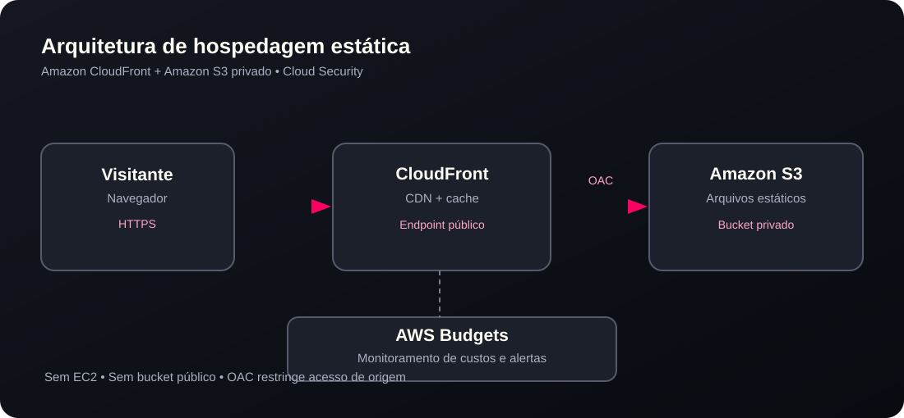

# Portfólio Pessoal na AWS | S3 + CloudFront + Cloud Security


> Site estático de apresentação profissional, projetos e cursos, publicado com armazenamento privado no Amazon S3 e distribuição global via Amazon CloudFront.

**Site publicado:** https://d9pw4we48nxly.cloudfront.net  
**Autor:** [Diogo Muller](https://github.com/DiogoMulller)  
**Área:** AWS · Cloud Computing · Cloud Security

## Visão geral

Este projeto reúne duas frentes de aprendizado:

1. **Frontend estático:** desenvolvimento de um portfólio responsivo em HTML, CSS e JavaScript puro, sem backend e sem dependências de frameworks JavaScript.
2. **Infraestrutura AWS:** publicação segura com Amazon S3 privado, CloudFront, Origin Access Control (OAC), HTTPS e acompanhamento de custos com AWS Budgets.

**Objetivo:** disponibilizar um site profissional sem provisionar servidores EC2, mantendo simplicidade operacional, controle de custos e acesso à origem restrito ao CloudFront.

## Arquitetura



**Fluxo de requisição:**

1. O visitante abre o endereço HTTPS da distribuição CloudFront.
2. O CloudFront responde pelo cache quando possível ou solicita o objeto ao bucket S3.
3. O OAC permite acesso do CloudFront à origem S3 por uma política específica de distribuição.
4. O bucket não precisa estar público para entregar HTML, CSS, JS e imagens aos visitantes.

> OAC **não é um serviço intermediário de rede**: é o mecanismo de autorização entre CloudFront e S3, representado no diagrama como controle de acesso.

## Serviços utilizados

| Serviço / recurso | Função neste projeto |
|---|---|
| **Amazon S3** | Armazenar arquivos estáticos do portfólio |
| **Amazon CloudFront** | Servir conteúdo por HTTPS e cache em pontos de presença |
| **Origin Access Control (OAC)** | Restringir a leitura de objetos S3 à distribuição autorizada |
| **S3 Block Public Access** | Evitar acesso público direto ao bucket |
| **AWS Budgets** | Alertar sobre consumo e projeção de custos da conta |
| **Git / GitHub** | Versionar o código e documentar a implementação |

## Funcionalidades do site

- Apresentação profissional em layout **Clean Dark** com identidade rosa/preto.
- Navegação responsiva em página única.
- Fundo animado de conexões Cloud com `Canvas 2D`.
- Quatro projetos com links aos repositórios GitHub.
- Seção de credenciais com **25 cursos/certificações informados pelo titular**, com botão **Mostrar todas**.
- Linha do tempo de formação acadêmica e experiência profissional.
- Acesso ao currículo e aos canais de contato.
- Capas minimalistas em SVG/CSS com animações leves no hover.

## Segurança: decisões de arquitetura

- **Bucket S3 privado:** não foi utilizado o endpoint público de hospedagem de sites do S3.
- **CloudFront com origem REST do S3:** permite integrar OAC.
- **Acesso à origem controlado:** durante a criação foi selecionado `Grant CloudFront access to origin = Yes`; o site foi aberto com sucesso pela distribuição.
- **HTTPS:** visitantes utilizam a URL HTTPS do CloudFront.
- **WAF desativado:** decisão inicial orientada a custo e baixa complexidade; isso **não** significa proteção completa contra ameaças de aplicação.
- **Nenhum segredo no frontend:** aplicações estáticas públicas não devem conter credenciais, tokens privados ou chaves AWS.

**Observação de validação:** a abertura pública do site foi confirmada pelo proprietário. A inspeção independente da política S3, teste de acesso direto negado à origem, cabeçalhos HTTPS e uso em dispositivos móveis ainda são recomendações de testes adicionais; não são alegados aqui como testes já executados.

## Controle de custos

Foi configurado na conta um orçamento mensal de **US$ 1,00** com três notificações:

| Condição | Limite |
|---|---:|
| Custo real acima de 20% | US$ 0,20 |
| Custo real acima de 50% | US$ 0,50 |
| Custo previsto acima de 100% | US$ 1,00 |

**Importante:** valores de orçamento **não são o custo do site**; incluem o escopo do orçamento da conta. Alertas não interrompem serviços e podem ocorrer depois de parte do consumo. Créditos promocionais e datas de validade foram deliberadamente omitidos deste repositório.

## Deploy realizado (Console AWS)

1. Criar bucket S3 e manter o bloqueio de acesso público habilitado.
2. Enviar `index.html`, `style.css`, `script.js` e `assets/` para a **raiz** do bucket.
3. Criar distribuição CloudFront com origem do tipo **Amazon S3**.
4. Selecionar acesso privado à origem / **OAC** e permitir que o assistente gerencie a política do bucket.
5. Usar configuração padrão de cache, sem Origin Shield ou WAF extra.
6. Configurar **Default root object** como `index.html`.
7. Conferir a conclusão da implantação e abrir a URL HTTPS da distribuição.
8. Ajustar e verificar notificações no AWS Budgets.

Consulte o [guia de publicação e atualização](docs/deployment.md) para detalhes operacionais e resolução de problemas.

## Estrutura do projeto

```text
portfolio-aws-github/
├── index.html
├── style.css
├── script.js
├── assets/
│   ├── icons/
│   ├── cloud-architecture.svg
│   ├── favicon.ico
│   └── ...
├── docs/
│   ├── architecture.svg
│   ├── deployment.md
│   └── evidencias/
│       └── README.md
├── .gitignore
└── README.md
```

## Executar localmente

```bash
python3 -m http.server 8000
```

Abra **http://localhost:8000** no navegador.

## Como atualizar o site na AWS

Edite os arquivos, teste localmente e substitua **somente os arquivos alterados** no S3. Como o CloudFront usa cache, pode ser necessário invalidar `/index.html`, `/style.css` ou `/script.js` na aba **Invalidations**. Para deploys frequentes, o próximo passo recomendado é versionar os assets e automatizar o envio com GitHub Actions e autenticação AWS OIDC (sem chaves permanentes).

## Evidências e melhorias futuras

As evidências recomendadas e orientações para evitar exposição de dados sensíveis estão em [docs/evidencias/README.md](docs/evidencias/README.md).

**Próximos passos:**
- Verificação documentada da política de acesso ao bucket e teste de acesso direto negado.
- Testes de responsividade e acessibilidade.
- Deploy automatizado com CI/CD.
- Domínio próprio, se houver necessidade e orçamento.
- Monitoramento de métricas, uso e custos.

## Aprendizados

Este laboratório consolidou conceitos de hospedagem estática, CDN, cache, origem privada, controle de acesso entre serviços AWS, HTTPS e governança financeira básica. O projeto não utiliza instâncias EC2 nem backend para disponibilizar páginas públicas.

## Referências oficiais

- [AWS — Restrict access to an Amazon S3 origin](https://docs.aws.amazon.com/AmazonCloudFront/latest/DeveloperGuide/private-content-restricting-access-to-s3.html)
- [AWS — Get started with a CloudFront standard distribution](https://docs.aws.amazon.com/AmazonCloudFront/latest/DeveloperGuide/GettingStarted.SimpleDistribution.html)
- [AWS — Managing costs with AWS Budgets](https://docs.aws.amazon.com/cost-management/latest/userguide/budgets-managing-costs.html)

---

**Projeto educacional e de portfólio.** AWS e as demais marcas citadas pertencem aos respectivos titulares; este projeto não representa endosso dessas organizações.
